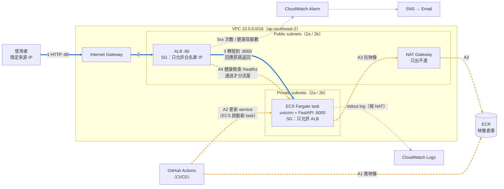
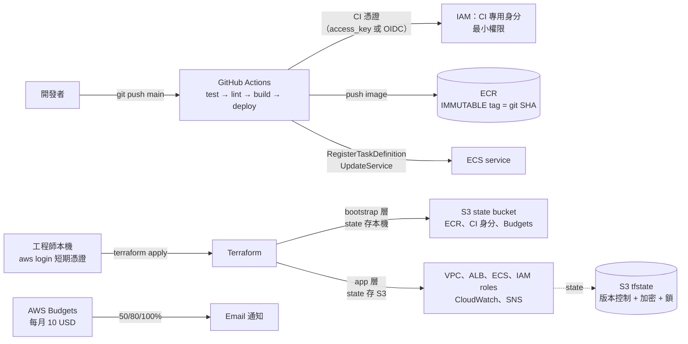

# orders-api

一個內部用的小服務，從程式碼一路自動部署到 AWS（ECS Fargate），並接上 CloudWatch 監控。
所有 AWS 資源皆以 Terraform 建立；CI/CD 使用 GitHub Actions（憑證放 GitHub Secrets，或使用 OIDC），repo 內不含任何 AWS 憑證或帳號 ID。

## 架構

分成兩張圖：**執行期**（使用者的請求怎麼走、怎麼被監控）與**交付與管理**（程式碼怎麼變成線上版本、基礎設施由誰建立）。

### 1. 執行期（請求路徑與監控）

三種線代表三個不同的時間點：**藍色實線 1–3** 是每次請求的路徑；**橘色虛線 A1–A4** 是部署時事先發生的（推映像 → ECS 啟動 task → 經 NAT 拉映像 → 健康檢查通過才分流量），請求進來時容器早已在執行；**灰色點線**是背景持續的 log、指標與告警。



### 2. 交付與管理（CI/CD、IaC、成本）



### 資源對照（43 個）

| 層 | 資源 | 數量 | 圖上位置 |
|---|---|---|---|
| bootstrap | AWS Budgets | 1 | 圖 2 |
| bootstrap | S3 state bucket（含 versioning、加密、封鎖公開存取） | 4 | 圖 2 |
| bootstrap | ECR repository + lifecycle policy | 2 | 圖 1、圖 2 |
| bootstrap | CI 專用 IAM user + policy + access key（OIDC 模式則為 provider + role + policy） | 3 | 圖 2 |
| app | VPC、Internet Gateway | 2 | 圖 1 |
| app | Subnets（public ×2、private ×2） | 4 | 圖 1 |
| app | NAT Gateway + EIP | 2 | 圖 1 |
| app | Route tables ×2 + associations ×4 | 6 | 細節，未畫（public 走 IGW、private 走 NAT） |
| app | Security groups ×2 + rules ×4 | 6 | 圖 1（標在 ALB / task 上） |
| app | ALB、Target Group、Listener | 3 | 圖 1 |
| app | ECS cluster、task definition、service | 3 | 圖 1、圖 2 |
| app | IAM execution role + policy attachment、task role | 3 | 細節，未畫（execution role 給 ECS 拉映像 / 寫 log；task role 無權限） |
| app | CloudWatch log group、alarm | 2 | 圖 1 |
| app | SNS topic + email subscription | 2 | 圖 1 |

| 放哪裡 | 資源 | 理由 |
|---|---|---|
| Public subnet | ALB、NAT Gateway | 需要被外部連入 / 需要對外出口 |
| Private subnet | ECS task | 不給 public IP，只接受 ALB 的流量（SG 對 SG） |

## 目錄結構

```
app/                 FastAPI 服務（summary.py 為純邏輯，方便單元測試）
data/orders.csv      20 筆訂單範例資料
tests/               pytest（34 項；改壞示範見 docs/demo.md、scripts/break.sh）
Dockerfile           multi-stage、non-root、內建 HEALTHCHECK
infra/bootstrap/     帳號層級、生命週期較長：Budgets、tfstate bucket、ECR、GitHub OIDC role
infra/app/           服務本身：VPC、ALB、ECS、IAM、CloudWatch Logs/Alarm、SNS
.github/workflows/   CI/CD：test → terraform 檢查 → build/push → 部署 ECS
scripts/             手動部署腳本（含每步計時，用於手動 vs 自動比較）
```

## API

| Method | Path | 說明 |
|---|---|---|
| GET | `/healthz` | 回 200 與目前版本（git SHA） |
| GET | `/summary` | 讀取 `data/orders.csv`，回傳每個商品總數量 |

```bash
$ curl -s localhost:8000/summary
{"total_quantity_by_product":{"Keyboard":44,"Monitor":12,"Mouse":27,"USB-C Cable":15,"Webcam":10}}
```

## 本機執行

```bash
pip install -r requirements-dev.txt
make test                  # 單元測試
make docker-run            # http://localhost:8000/healthz , /summary
```

## 部署到 AWS（從零開始）

前置：Terraform ≥ 1.10、AWS CLI ≥ 2.32、Docker、jq。

本機一律使用短期憑證，不建立個人的長期 access key。

- **新版免費方案帳號（本練習）**：沒有 root、無法使用 IAM Identity Center，IAM user 也不能登入 Console。
  以 AWS Builder ID（Google 等）登入專案，CLI 用 `aws login` 取得同一身分的短期憑證（12 小時）。
  為讓 Terraform 穩定取得憑證，在 `~/.aws/config` 加一個轉接 profile：

  ```ini
  [profile orders]
  credential_process = aws configure export-credentials --profile orders-login --format process
  region = ap-southeast-2
  ```

  ```bash
  aws login --profile orders-login --remote   # 瀏覽器登入並選擇專案；WSL 用 --remote
  export AWS_PROFILE=orders
  aws sts get-caller-identity
  aws ecs list-clusters                       # 回 {"clusterArns": []} 代表區域正確
  ```

- **一般帳號 / 付費方案（較佳做法）**：IAM Identity Center（`aws configure sso` + `aws sso login`），
  搭配 Organizations 分 dev / prod 帳號，並啟用 GuardDuty、Security Hub。

```bash
# 0. 填變數（tfvars 不進 repo）
cp infra/bootstrap/terraform.tfvars.example infra/bootstrap/terraform.tfvars
cp infra/app/terraform.tfvars.example       infra/app/terraform.tfvars

# 1. 預算告警 + state bucket + ECR + CI 身分
make bootstrap
make ci-secrets            # 用 gh CLI 把 CI 憑證寫入 GitHub Secrets

# 2. 推第一個映像（印出 IMAGE_TAG）
make push-initial

# 3. 建立服務環境
make infra-up IMAGE_TAG=<上一步的 tag>
make outputs               # 取得 alb_url

# 4. 之後 push 到 main 即自動部署
```

> SNS 訂閱確認信需到信箱點擊確認，告警才會寄出。

## 部署流程與責任切分

- **Terraform** 管基礎設施；**CI** 管「跑哪個版本」。`aws_ecs_service` 設定 `ignore_changes = [task_definition]`，
  避免 CI 部署後 `terraform plan` 出現假性差異。
- 映像 tag = git commit SHA，ECR 設為 IMMUTABLE → 線上版本可追溯、可回滾。
- 部署採 rolling update（min 100% / max 200%），並啟用 **deployment circuit breaker + 自動回滾**。

## 監控

- 容器 stdout/stderr → CloudWatch Logs `/ecs/orders-api`（保留 7 天）
- Alarm `orders-api-5xx-or-down`（metric math，一個 alarm 涵蓋兩種情況）：
  - ALB 5xx（target + ELB）每分鐘 ≥ 5，或
  - Target Group 健康主機數 < 1
  - 3 分鐘內 2 分鐘成立即觸發 → SNS Email；恢復時也通知

## 拆除

```bash
make destroy-all     # 先拆 app，再拆 bootstrap（ECR 映像、state bucket 會一併刪除）
```

## 安全與成本

- CI 憑證有兩種模式（`ci_auth_mode`），同一份最小權限 policy：只能推這個 ECR repo、只能更新這個 ECS service、
  只能 PassRole 本專案的 task role。

  | 模式 | 適用 | 做法 |
  |---|---|---|
  | `access_key`（預設） | 新版免費方案帳號：SCP 禁止 `iam:*Provider*`，無法建立 OIDC provider | CI 專用 IAM user 的金鑰放 GitHub Secrets；`terraform destroy` 即刪除 |
  | `oidc`（較佳） | 一般帳號 / 付費方案 | 無長期金鑰；trust policy 只允許本 repo 的 `main` 分支取得 1 小時憑證；repo variable `AWS_AUTH_MODE=oidc` |

- `*.tfstate`、`*.tfvars`、`backend.hcl` 皆在 `.gitignore`。
- 環境存活期間主要費用：NAT Gateway、ALB、Fargate（0.25 vCPU / 0.5 GB）、Public IPv4，
  約每小時 0.1 美元等級；已設 AWS Budgets 告警，截圖後立即 `make destroy-all`。
